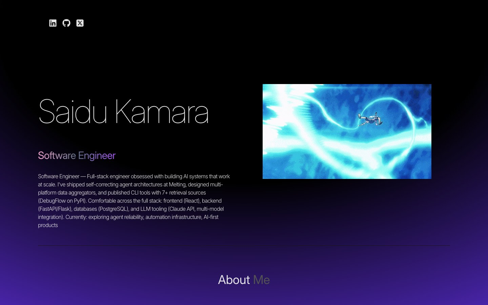

# Saidu Kamara — Portfolio

My personal portfolio site: a single-page React app that introduces who I am, the tools I work with, my experience, and the projects I've shipped.

**Live site:** https://saiduportfolio.netlify.app/



## What's on the page

- **Hero:** name, role, and a short summary of the kind of engineering I do
- **About:** background and how I approach building software
- **Technologies:** the stack I work with day to day
- **Experience:** roles at Melting and General Assembly
- **Projects:** featured work with screenshots, descriptions, tech tags, and links
- **Contact:** how to reach me

## Featured projects

| Project | What it is | Links |
| --- | --- | --- |
| **HealthFlow** | Agent workspace Medicare brokers use to compare plans, translate dense benefits, and draft appeals, with a PHI-aware record under every recommendation | [Live](https://healthflow.work/) · [GitHub](https://github.com/saikamara59/healthflow) |
| **A New York Thrift Store** | Full-stack e-commerce store for vintage and thrifted clothing | [GitHub](https://github.com/saikamara59/thrift-store-react) |
| **DebugFlow** | CLI that reads your codebase and explains Python errors in context instead of giving generic fixes | [GitHub](https://github.com/saikamara59/debugflow) |
| **OverTurn** | AI-assisted denial management that turns payer denial files into a deadline-prioritized worklist and appeal drafts for human review | [Live](https://overturn.up.railway.app/) · [GitHub](https://github.com/saikamara59/overturn) |
| **Pick a Date** | Date-invite generator: she picks the area, food, activity, real places, and a time; he gets her picks, a calendar invite, and an AI game plan | [Live](https://saidusdatenight.netlify.app/) · [GitHub](https://github.com/saikamara59/pick-a-date) |

## Built with

- [React 18](https://react.dev/) + [Vite](https://vite.dev/)
- [Tailwind CSS](https://tailwindcss.com/)
- [Motion](https://motion.dev/) for scroll and entrance animations
- [React Icons](https://react-icons.github.io/react-icons/)
- Deployed on [Netlify](https://www.netlify.com/)

## Run it locally

Requires Node.js 18 or newer.

```bash
git clone https://github.com/saikamara59/react-portfolio.git
cd react-portfolio
npm install
npm run dev
```

Then open the URL Vite prints (usually http://localhost:5173).

| Command | What it does |
| --- | --- |
| `npm run dev` | Start the dev server with hot reload |
| `npm run build` | Build the production site into `dist/` |
| `npm run preview` | Serve the production build locally |
| `npm run lint` | Run ESLint |

## Updating content

Almost all of the text on the site lives in [`src/constants/index.js`](src/constants/index.js):

- `HERO_CONTENT` and `ABOUT_TEXT`: the intro copy
- `EXPERIENCES`: the experience timeline
- `PROJECTS`: the project cards
- `CONTACT`: contact details

To add a project, put a screenshot in `src/assets/projects/`, import it at the top of `src/constants/index.js`, and add an entry to `PROJECTS`:

```js
{
  title: "Project name",
  image: projectImage,
  description: "One or two sentences on what it does and who it's for.",
  technologies: ["React", "FastAPI"],
  website: "https://live-site.example", // optional
  github: "https://github.com/saikamara59/repo", // optional
}
```

The card's image and description link to `website` if there is one, otherwise to `github`. When a project has both, a GitHub icon appears next to its title.

## Project structure

```
src/
  App.jsx              page layout and section order
  components/          one component per section (Hero, About, Projects, ...)
  constants/index.js   all site copy and project data
  assets/              profile photo and project screenshots
```

## Deployment

The site is hosted on Netlify and deploys automatically whenever `main` changes, so merging a pull request publishes it. The build settings live in the Netlify dashboard (there's no `netlify.toml`); a standard Vite setup builds with `npm run build` and publishes `dist/`.

## Contact

- LinkedIn: https://www.linkedin.com/in/saidu-kamara-3285b82ba
- GitHub: https://github.com/saikamara59
